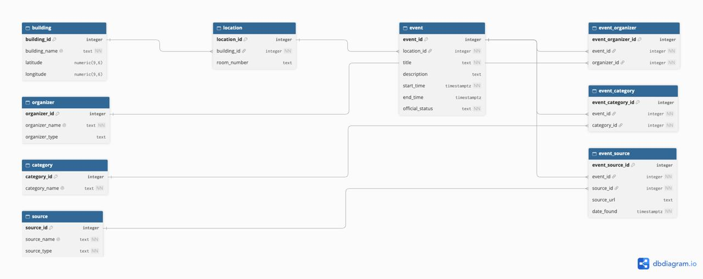

# CatCruxis (The CC) Documentation

**DAT 153 — Team SQLarpers**

## Project team

| Member | GitHub |
|---|---|
| Rainul Hakim | RainulHakim |
| Jonathan | Jogarenas |

| Sprint | Product Owner | Scrum Master | Developer |
|---|---|---|---|
| 01 | Rainul | Jonathan | Rainul & Jonathan |
| 02 | Jonathan | Rainul | Jonathan & Rainul |
| 03 | Rainul | Jonathan | Rainul & Jonathan |
| 04 | | | |
| 05 | | | |
| 06 | | | |

## Source data

Students find events in a lot of places: WildcatSync, Handshake, Hurt Hub, department emails. CatCruxis puts them in one database. We have two real sources we can pull automatically...and more to come ;

- WildcatSync RSS feed: https://wildcatsync.davidson.edu/events.rss (where student orgs and departments post)
- Hurt Hub events API: https://hurthub.davidson.edu/wp-json/tribe/events/v1/events (JSON)

This is Option 2. The sources decided what our tables look like.

### WildcatSync field mapping

How the WildcatSync fields map to our tables:

| Feed field | Table.column |
|---|---|
| title | event.title |
| description | event.description |
| events:start / events:end | event.start_time / event.end_time |
| events:location | building.building_name and location.room_number |
| events:host | organizer.organizer_name, plus event_organizer |
| category | category.category_name, plus event_category |
| link | event_source.source_url |

### Hurt Hub field mapping

And the Hurt Hub fields:

| API field | Table.column |
|---|---|
| title | event.title |
| description | event.description |
| utc_start_date / utc_end_date | event.start_time / event.end_time |
| venue (name and address) | building.building_name and location.room_number |
| organizer (a list) | organizer.organizer_name, plus event_organizer |
| categories (a list) | category.category_name, plus event_category |
| url | event_source.source_url |

### Data characteristics and integration considerations

Things in the data that shaped the design: a WildcatSync event can have several hosts (one had nine), and Hurt Hub gives a list of organizers and a list of categories too. WildcatSync locations are free text, spelled different ways, and virtual events have a Zoom link there. Hurt Hub titles come HTML-encoded, so the ETL has to clean them.

Neither source has official_status, so we set it ourselves. We also make up the source rows and look up building coordinates by hand. Handshake, department email and student submissions can't be scraped, so those events will be made up.

## Database design

### ER diagram



Made in dbdiagram.io from `images/schema.dbml` (copied in the appendix). Each line is a foreign key. The crow's foot end is the table that has the foreign key column. dbdiagram only draws the many side, so the rest is in these rules:

1. A location is in exactly one building. A building has zero or more locations.
2. An event is at exactly one location. A location has zero or more events. Online or undecided events use a location in a building called "Online / TBD".
3. An event has one or more organizers. An organizer has zero or more events (event_organizer).
4. An event has one or more categories. A category has zero or more events (event_category).
5. An event is on one or more sources. A source has zero or more events (event_source).

The database can't force "at least one" organizer, category and source on an event. We'll make sure of that in the Sprint 04 load script.

### 3NF analysis

#### Functional dependencies

Every table has a surrogate primary key (`table_name_id`), so that column determines all the others. The other dependencies:

- building: building_name is unique, so building_name determines latitude and longitude too.
- location: the pair (building_id, room_number) is unique, so it determines location_id.
- event: nothing besides the key. We tried title → description and title → location_id, but they don't hold. The Voter Registration Tabling events share a title and have different days and places.
- organizer and source: the name is unique, so it determines the other columns.
- category: category_name is unique.
- event_organizer, event_category: only the two foreign keys, which are unique as a pair.
- event_source: (event_id, source_id) is unique and determines source_url and date_found.

#### Normal forms

**1NF:** every column holds a single value. Hosts, categories and sources aren't stored as lists in event, they're in the bridge tables. Building and room are separate columns in location.

**2NF:** every table has a one-column primary key, so a column can't depend on only part of it. For event_source we also checked the pair (event_id, source_id), and source_url and date_found depend on the whole pair.

**3NF:** in every table the non-key columns depend only on the key. The one place this failed was the old location table, covered in Changes since Sprint 02.

#### Sprint 02 flags

| Flag | Result |
|---|---|
| location_name repeats building_name and room_number | Fixed. Removed location_name. |
| latitude and longitude depend on the building | Fixed. Moved to a new building table (Changes since Sprint 02). |
| Same place spelled different ways | Not a 3NF issue. UNIQUE constraints stop exact duplicates, and the ETL will clean up the spellings. |
| Weekly events repeat title and description | Fine. Each one is a separate event with its own date, and title doesn't determine any other column. |
| Organizer names differ between sources | Fine. organizer_name is unique and the ETL will match names up. |

We didn't denormalize anything.

### Changes since Sprint 02

1. Added the building table and moved latitude and longitude into it. Dropped location_name and building_name from location.
2. Event to location is exactly one everywhere (Sprint 02 said "at most one" in one place). Virtual events use the "Online / TBD" building so event.location_id can be NOT NULL.
3. Added data types, NOT NULL, UNIQUE and CHECK constraints.
4. Added a UNIQUE pair to each bridge table so the same link can't go in twice.
5. official_status is now `official` or `student_organized`, and organizer_type is `student_organization`, `department`, `campus_center` or `student_community`. These match the values in our frontend prototype.
6. source_type is `platform`, `website`, `email` or `student_submission`.
7. Deleting an event also deletes its rows in the bridge tables.

### Tables, views, and functions/procedures

#### Tables

- **building:** a place on campus with its coordinates. Also holds "Online / TBD" for virtual events.
- **location:** a building plus an optional room. Many events can share one.
- **event:** one event at one date and time. A weekly meeting is a new row each week.
- **organizer:** a group that hosts events, with a type.
- **event_organizer:** bridge table, one row per organizer hosting an event.
- **category:** a label like Social or Athletics.
- **event_category:** bridge table, one row per category on an event.
- **source:** where an event was found (WildcatSync, Handshake, Hurt Hub, email, student submission).
- **event_source:** bridge table, one row per event on a source, with the link and the date we found it.

Many-to-many relationships: event/organizer, event/category and event/source. The event table connects to four others (location, organizer, category, source). No self-referencing keys.

#### Views

#### Functions/procedures

## Analysis and reflection questions

### Data sourcing and integration

### Design reflection

### Deployment and migration reflection

### Project outcomes and learning

To be written in later sprints.

## Acknowledgments

dbdiagram.io for the ER diagram.

## Appendix: DBML

```dbml
Table building {
  building_id integer [pk]
  building_name text [not null, unique]
  latitude numeric(9,6)
  longitude numeric(9,6)
}

Table location {
  location_id integer [pk]
  building_id integer [not null]
  room_number text
  indexes {
    (building_id, room_number) [unique]
  }
}

Table event {
  event_id integer [pk]
  location_id integer [not null]
  title text [not null]
  description text
  start_time timestamptz [not null]
  end_time timestamptz
  official_status text [not null]
}

Table organizer {
  organizer_id integer [pk]
  organizer_name text [not null, unique]
  organizer_type text
}

Table category {
  category_id integer [pk]
  category_name text [not null, unique]
}

Table source {
  source_id integer [pk]
  source_name text [not null, unique]
  source_type text [not null]
}

Table event_organizer {
  event_organizer_id integer [pk]
  event_id integer [not null]
  organizer_id integer [not null]
  indexes {
    (event_id, organizer_id) [unique]
  }
}

Table event_category {
  event_category_id integer [pk]
  event_id integer [not null]
  category_id integer [not null]
  indexes {
    (event_id, category_id) [unique]
  }
}

Table event_source {
  event_source_id integer [pk]
  event_id integer [not null]
  source_id integer [not null]
  source_url text
  date_found timestamptz [not null]
  indexes {
    (event_id, source_id) [unique]
  }
}

Ref: location.building_id > building.building_id
Ref: event.location_id > location.location_id
Ref: event_organizer.event_id > event.event_id
Ref: event_organizer.organizer_id > organizer.organizer_id
Ref: event_category.event_id > event.event_id
Ref: event_category.category_id > category.category_id
Ref: event_source.event_id > event.event_id
Ref: event_source.source_id > source.source_id
```